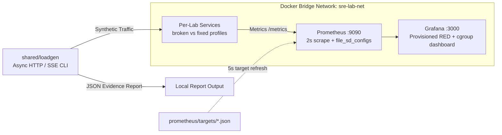

# sre-reliability-labs

Controlled, locally reproducible reliability failure-mode labs covering Linux cgroups, Kubernetes pod lifecycle mechanics, distributed retry metastability, and AI inference queuing behavior.

## Problem This Solves

Production outages rarely look like unit-test bugs. Tail latency spikes at 20% average CPU, rolling updates drop in-flight requests despite passing readiness checks, and naive retry policies turn brief downstream slowdowns into self-sustaining overload. This repository reproduces those exact failure mechanics locally with measurable before/after telemetry rather than hand-waving explanations.

## Who It Is For

- Site Reliability Engineers and Platform Engineers investigating kernel, container, Kubernetes, and distributed-systems failure modes.
- ML/AI Infrastructure Engineers applying queuing, admission control, and tail-latency discipline to streaming inference workloads.
- Interviewers and peers reviewing concrete diagnostic methodology and quantitative evidence.

## Methodology

Every lab enforces the same scientific workflow, comparing a **broken** baseline against a **fixed** profile under identical synthetic load:

```text
OBSERVATION -> HYPOTHESIS -> TEST -> EVIDENCE -> ROOT CAUSE -> FIX -> PREVENTION
```

Each lab captures deterministic client-side latency/error reports from `shared/loadgen` alongside server-side and container telemetry scraped by Prometheus.

## Planned Lab Roadmap

| # | Lab | Runtime | Core Failure Mode | Status |
|---|---|---|---|---|
| 01 | [`01-cgroup-cpu-throttling`](labs/01-cgroup-cpu-throttling/README.md) | Docker Compose | CFS CPU quota throttling causing p99 divergence at low average CPU | Complete |
| 02 | [`02-oomkill-memory-pressure`](labs/02-oomkill-memory-pressure/README.md) | Docker Compose | Unbounded cache growth hitting `memory.max` -> kernel OOM kill (`exit 137`) | Complete |
| 03 | `03-k8s-probe-death-spiral` | `kind` | Coupled liveness probes causing cascading restarts during downstream slowdowns | Planned |
| 04 | `04-k8s-drain-traffic-blackhole` | `kind` | Async EndpointSlice/kube-proxy propagation dropping requests during rollouts | Planned |
| 05 | `05-retry-storm-metastability` | Docker Compose | Unjittered retries amplifying partial faults into metastable overload | Planned |
| 06 | `06-llm-inference-hol-blocking` | Docker Compose | FIFO inference gateway head-of-line blocking and KV-cache saturation (TTFT/TPOT) | Planned |

## Architecture



## Quickstart

### Prerequisites

- Docker with `docker compose` plugin
- Python 3.11+ and `uv`

### Start Shared Observability Stack

```bash
make obs-up
make obs-status
```

- Prometheus UI: `http://localhost:9090`
- Grafana UI: `http://localhost:3000` (loads **SRE Baseline — RED & Container Signals** by default)

### Install & Test `loadgen`

```bash
cd shared/loadgen
uv sync --extra dev
cd ../..
make loadgen-lint
make loadgen-test
```

### Run Smoke Test Against Prometheus

```bash
make smoke-test
```

Stop the stack when finished:

```bash
make obs-down
```

## Key Design Decisions

- **Dynamic target registration (`file_sd_configs`):** Individual labs drop a target JSON file into `shared/observability/prometheus/targets/` (gitignored) instead of editing `prometheus.yml` or restarting Prometheus. Targets appear within 5 seconds.
- **2-second scrape interval (`scrape_interval: 2s`):** Labs run short, controlled fault injections (30–120s). A `2s` scrape interval captures sharp tail-latency and throttling transitions. In production, `15s–60s` intervals are standard because `2s` scraping multiplies TSDB ingestion rate, cardinality memory footprint, and storage cost by 7.5x–30x.
- **Portable Docker network (`sre-lab-net`):** A single named bridge network allows each future lab compose file to attach cleanly without hardcoding host paths or container-runtime specifics.
- **Deterministic synthetic workloads:** Lightweight services isolate kernel, kubelet, and queuing physics directly rather than hiding them behind heavy external databases or GPU hardware requirements.

## Security Notes

- Grafana runs with `GF_AUTH_ANONYMOUS_ENABLED=true` and `GF_AUTH_ANONYMOUS_ORG_ROLE=Admin` **strictly for ephemeral local lab ergonomics** on loopback. Never expose this compose stack to untrusted networks or copy these environment variables into shared/production deployments.
- Prometheus exposes `--web.enable-lifecycle` for local config reloads; keep ports bound to local development environments only.

## Limitations

- Container CPU/memory metrics on macOS run inside a Linux VM managed by the local container runtime (Docker Desktop, OrbStack, Colima, etc.); absolute latencies differ slightly from bare-metal Linux, though relative broken-vs-fixed behavior remains faithful.
- Single-host `kind` and Docker Compose topologies cannot reproduce multi-AZ network partitions or real hardware packet loss without synthetic fault injection.
